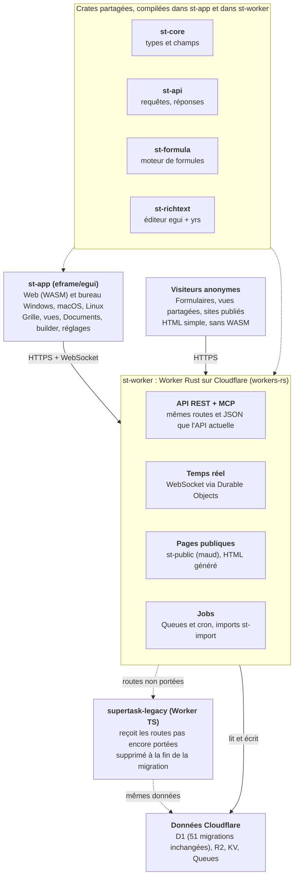

# Plan de réécriture de Supertask en Rust (eframe/egui)

7 novembre 2026

Supertask passe entièrement en Rust. Le backend tourne en Rust sur Cloudflare Workers (workers-rs). Toute l'application connectée passe en eframe/egui, pour le web (WASM) et le bureau. Les pages publiques (formulaires, vues partagées, sites publiés) sont du HTML généré par le Worker Rust.

La migration se fait route par route, derrière la même API et la même base D1, sans grande bascule. Ordre de grandeur : 18 à 24 mois pour une personne, avec une première version egui utilisable vers le mois 9.

## Architecture cible

Un seul code Rust, de l'app egui jusqu'à la base D1.

L'app egui et le Worker partagent les mêmes crates : un champ, un filtre ou une formule s'écrit une fois et se comporte pareil des deux côtés. Le Worker TS reste branché derrière le Worker Rust jusqu'à la fin de la migration.

## Périmètre

Il y a environ 360 000 lignes à réécrire : 296 000 côté interface (Vue/TS) et 64 500 côté backend (TS sur Workers). Les 51 migrations SQL de D1 et les fichiers de traduction sont repris tels quels.

| Module | Couche | Lignes aujourd'hui | Cible Rust |
| --- | --- | ---: | --- |
| core (shell, connexion, espaces de travail, réglages, admin) | Interface | 81 200 | st-app (egui) |
| database (grille, 8 types de vues, 28 types de champs, filtres) | Interface | 79 700 | st-app (egui) |
| builder (éditeur de sites) | Interface | 37 600 | éditeur egui + rendu HTML st-public |
| reste du frontend (Nuxt, plugins, config) | Interface | 35 600 | remplacé par eframe + crates partagées |
| premium | Interface | 25 600 | st-app (egui) |
| enterprise | Interface | 18 300 | st-app (egui) |
| automation | Interface | 6 800 | éditeur de graphe egui |
| integrations | Interface | 5 700 | st-app (egui) |
| dashboard | Interface | 2 700 | egui_plot |
| documents | Interface | 2 600 | st-richtext (egui + yrs) |
| whiteboards | Interface | 600 | st-app (egui) |
| routes base de données (tables, champs, lignes, vues, webhooks) | Backend | 11 700 | st-worker |
| import Airtable et data sync | Backend | 6 200 | st-import |
| builder | Backend | 4 700 | st-worker + st-public |
| automatisations | Backend | 3 400 | st-worker |
| moteur de formules | Backend | 2 800 | st-formula (partagé avec le client) |
| assistant IA et MCP | Backend | 2 800 | st-worker |
| connexion, SSO, 2FA | Backend | 2 000 | st-worker |
| dashboards, documents, collaboration | Backend | 1 700 | st-worker (Durable Objects) |
| reste (espaces de travail, fichiers, corbeille, snapshots, modèles, jobs, cron) | Backend | 29 300 | st-worker |

## Choix techniques par brique

Toutes les briques ont un équivalent Rust, sauf deux qui sont à écrire en grande partie : l'éditeur de texte riche collaboratif et l'accessibilité du web en canvas. Les points marqués « à valider » sont vérifiés en phase 0.

| Brique | Aujourd'hui | En Rust | Risque |
| --- | --- | --- | --- |
| Application connectée | Nuxt 3 / Vue 3 | eframe/egui, un seul code pour le web (WASM) et le bureau (Windows, macOS, Linux) | Moyen |
| Grille de milliers de lignes | composants Vue virtualisés | egui_extras TableBuilder, lignes virtualisées | Faible |
| Texte riche collaboratif (Documents, champs texte riche) | TipTap/ProseMirror + Yjs + Hocuspocus | widget d'édition maison sur la mise en page de texte d'egui + yrs, compatible avec les documents Yjs existants | Élevé |
| Pages publiques (formulaires, vues partagées, sites publiés) | Nuxt | HTML généré par le Worker (maud), formulaires sans JavaScript | Moyen |
| Graphiques des dashboards | Chart.js | egui_plot | Faible |
| Éditeur d'automatisations | Vue Flow | graphe de nœuds egui (egui-snarl) | Moyen |
| Temps réel côté client | WebSocket du navigateur | ewebsock (web et natif) | Faible |
| API HTTP | Hono sur Workers | crate worker (workers-rs) + routeur | Faible |
| D1, KV, R2, Queues | bindings TS | bindings workers-rs (R2 multipart à valider) | Faible |
| Durable Objects (salles temps réel, sessions MCP) | DO TS avec stockage SQLite | DO workers-rs + WebSocket (stockage SQLite à valider) | Moyen |
| Moteur de formules | TS côté Worker, parser ANTLR côté interface | une crate partagée, le même code dans le Worker et dans l'app | Faible |
| Import Airtable | @cloudflare/puppeteer + Browser Rendering | API REST de Browser Rendering appelée depuis Rust | Moyen |
| Workers AI, Vectorize, Images | bindings TS | bindings workers-rs si disponibles, sinon API REST Cloudflare (à valider) | Moyen |
| Data sync PostgreSQL | cloudflare:sockets | sockets workers-rs + tokio-postgres (à valider) | Moyen |
| SSO SAML | TS | crate SAML compilable en WASM ; les plus courantes dépendent de bibliothèques C (à valider) | Élevé |
| Traductions | vue-i18n (JSON) | fluent-rs, fichiers convertis par script | Faible |
| Accessibilité | DOM natif | AccessKit sur le bureau ; sur le web, egui reste un canvas | Élevé sur le web |

## Stratégie de migration

On ne bascule jamais tout d'un coup : un Worker Rust se place devant le Worker TS et reprend les routes une par une, sur les mêmes données. À tout moment, la production marche, et chaque étape peut être annulée en renvoyant une route vers le TS.

1. **Un Worker Rust reçoit tout le trafic** de `task.mabza.dev/api/*`, `/ws/*` et `/mcp/*`. Ce qu'il ne sait pas encore traiter, il le passe au Worker TS, renommé `supertask-legacy`, par service binding.
2. **Les données ne bougent pas.** Même base D1 (les 51 migrations restent la référence), même bucket R2, mêmes files Queues. Le Rust envoie des messages au même format, et le consommateur reste en TS jusqu'au portage des jobs. Les Durable Objects TS restent joignables depuis le Rust tant qu'ils ne sont pas portés.
3. **L'API reste identique.** Mêmes routes, mêmes JSON, mêmes jetons d'API, mêmes endpoints MCP. Le frontend Nuxt actuel tourne donc sur le backend Rust, et l'app egui peut parler aux deux.
4. **Une route ne passe en Rust que si ses tests différentiels sont verts** : la même requête est envoyée aux deux Workers et les réponses sont comparées.
5. **L'app egui grandit à côté de Nuxt**, à une adresse séparée (par exemple `task.mabza.dev/app/`). Nuxt reste l'interface par défaut jusqu'à la parité. Les pages publiques passent au HTML généré par Rust au fil des phases.
6. **Fin de la migration** : le Worker TS et le site Nuxt sont supprimés, egui devient l'interface par défaut.

## Phases et calendrier

Une première version egui au mois 9, la fin de la migration au mois 24. Les mois comptent depuis le démarrage ; c'est un ordre de grandeur pour une personne.

| Phase | Mois | Livrables | Porte de passage |
| --- | --- | --- | --- |
| 0 · Validations | 1 | Spikes workers-rs, SAML, app egui minimale | go/no-go écrit |
| 1 · Cœur partagé | 2 à 3 | st-core, st-api, st-formula | |
| 2 · Backend base de données | 3 à 7 | Auth, tables, champs, lignes, vues, fichiers | |
| 3 · App egui, première version | 5 à 9 | Grille, 28 types de champs, fiche, temps réel | 1re version egui utilisable |
| 4 · Vues et collaboration | 9 à 12 | Galerie, kanban, calendrier, formulaires | |
| 5 · Texte riche et Documents | 11 à 14 | st-richtext + yrs, documents Yjs existants | |
| 6 · Builder, automatisations, IA | 13 à 19 | Dashboards, assistant, MCP, pages publiques | |
| 7 · Entreprise et premium | 18 à 22 | SSO, rôles, imports, data sync, apps bureau | |
| 8 · Bascule | 23 à 24 | Nuxt et Worker TS supprimés | parité validée, fin de la migration |

Les phases se chevauchent : le backend d'une zone part en premier, l'interface egui suit dès que ses routes sont en Rust. Le calendrier est recalé au go/no-go de la phase 0, qui dira si les briques à risque tiennent.

## Tests, build et CI

La parité est garantie par des tests différentiels contre le Worker TS. Le temps de CI repose sur un cache de compilation persistant : en Rust, c'est la compilation qui coûte, pas l'exécution des tests. Aujourd'hui, un passage complet prend environ 4 min.

- **Tests unitaires** : `cargo nextest` sur chaque crate. Les jeux de cas JSON existants (`tests/cases/*.json` : formules, contenu TipTap) sont relus tels quels par les tests Rust.
- **Tests différentiels** : un banc envoie la même suite de requêtes HTTP au Worker TS et au Worker Rust (tous deux sous `wrangler dev`) et compare statut, en-têtes utiles et JSON. C'est la porte de passage de chaque route.
- **Tests d'interface** : egui_kittest pilote l'app par l'arbre d'accessibilité et compare des captures d'écran de référence.
- **Build** : cible `wasm32-unknown-unknown` pour le Worker (worker-build) et pour l'app web (trunk + wasm-opt) ; binaires natifs pour le bureau.
- **CI sur les 2 runners auto-hébergés** : le dossier `target/` est conservé d'un passage à l'autre, plus sccache, pour ne recompiler que les crates touchées. Objectif : rester sous 6 min avec cache ; un build à froid sera nettement plus long.
- **Budget de taille WASM** : fixé en phase 0, mesuré à chaque build, le CI échoue s'il est dépassé.
- **Apps de bureau** : les builds macOS (et leur signature) demandent un runner Mac, Windows un runner Windows ou une compilation croisée.

## Risques et parades

Deux risques peuvent remettre le plan en cause : l'éditeur de texte riche et l'expérience web en canvas. Tous deux sont testés en phase 0, avant d'engager le reste.

| Risque | Conséquence | Parade | Vérifié en |
| --- | --- | --- | --- |
| Éditeur de texte riche collaboratif à écrire de zéro | Documents et champs texte riche bloqués | Version minimale d'abord (paragraphes, titres, listes, gras, italique, liens, mentions), tableaux, code et maths ensuite ; yrs garde les documents Yjs existants lisibles | Phase 0 (prototype), phase 5 |
| Web en canvas : accessibilité, sélection de texte, Ctrl+F, saisie mobile | Utilisateurs web gênés | Pages publiques en HTML ; mesures sur mobile en phase 0 ; Nuxt reste en repli jusqu'à la parité | Phase 0 |
| Taille et démarrage du WASM | Premier chargement lent | Budget de taille vérifié par le CI, wasm-opt, chargement progressif | Phase 0, puis chaque build |
| Fonctions Cloudflare absentes de workers-rs (stockage SQLite des DO, Vectorize, Images, Browser Rendering) | Une brique ne peut pas passer en Rust | API REST Cloudflare, ou petit Worker JS dédié appelé par service binding | Phase 0 |
| SAML en WASM | SSO bloqué | Laisser le SSO dans un Worker TS minimal | Phase 0 |
| Le produit évolue pendant 18 à 24 mois | Parité qui recule sans cesse | Gel des nouvelles fonctions côté TS, ou toute nouvelle fonction écrite directement en Rust | Chaque phase |
| Temps de compilation | CI plus lente qu'aujourd'hui | Cache persistant, sccache, découpage fin en crates | Phase 1 |

## Décisions à prendre

Six choix fixent la suite. Le premier est déjà pris dans ce plan (egui au maximum), les cinq autres restent ouverts.

- [x] Interface connectée en egui, sur le web comme sur le bureau.
- [ ] Pages publiques (formulaires, vues partagées, sites du builder) : HTML généré par Rust (recommandé), ou egui aussi.
- [ ] Hébergement du backend : rester sur Cloudflare Workers avec workers-rs (recommandé, rien à migrer côté données), ou un serveur Axum sur notre machine.
- [ ] Apps de bureau à livrer : Linux, Windows, macOS, et comment les distribuer et les signer.
- [ ] Gel des nouvelles fonctions côté TS pendant la migration, oui ou non.
- [ ] Ordre des modules après la base de données : builder, automatisations, dashboards ou Documents en premier.

## Phase 0 : les trois premières semaines

La phase 0 ne livre rien aux utilisateurs : elle prouve que chaque brique à risque marche en Rust, et se termine par un go/no-go écrit qui recale le calendrier.

- [x] Créer le workspace Cargo avec les crates du schéma (vides, CI qui compile et teste).
- [ ] Mettre un Worker Rust devant le Worker TS par service binding, en local puis en production sur une route de test. *(Fait en local ; la production reste à faire.)*
- [x] Valider dans workers-rs : D1, KV, R2 (dont multipart), Queues (envoi et consommation), Durable Objects avec stockage SQLite et WebSocket, Workers AI, Vectorize, Browser Rendering. *(Tout marche sauf Vectorize, non testé faute de simulateur local.)*
- [ ] Compiler une crate SAML en `wasm32` et valider une connexion SSO de test. *(`saml-rs` compile ; la connexion SSO reste à tester.)*
- [x] App eframe minimale, web et bureau : connexion via l'API actuelle, liste des espaces de travail, grille de 10 000 lignes.
- [x] Mesurer sur cette app : taille du WASM, temps de démarrage, fluidité du défilement, saisie sur mobile. *(Sauf la saisie sur mobile.)*
- [x] Prototype d'éditeur egui + yrs qui ouvre et modifie un document Supertask existant.
- [x] Banc de tests différentiels sur 3 routes (connexion, liste des lignes, création de ligne).
- [x] Écrire le go/no-go : ce qui marche, ce qui demande un repli, calendrier recalé. Voir [docs/rust/phase0-bilan.md](rust/phase0-bilan.md) : **go**.
